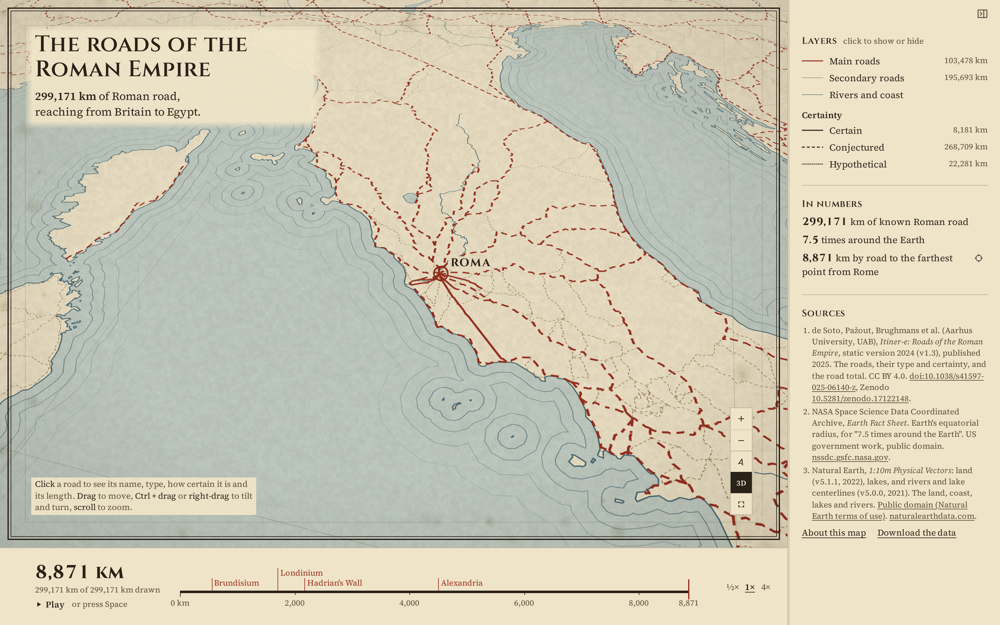
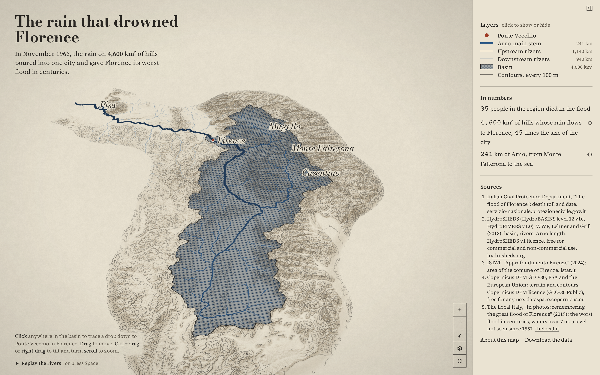
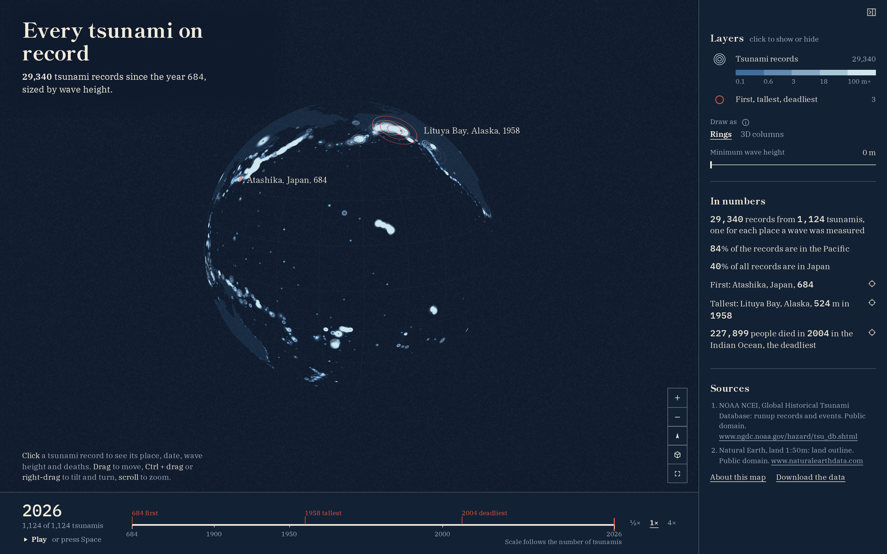
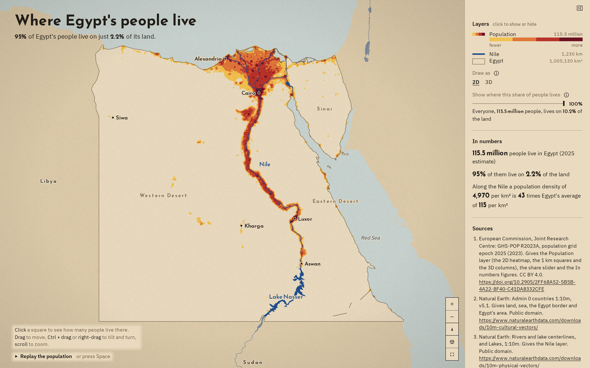
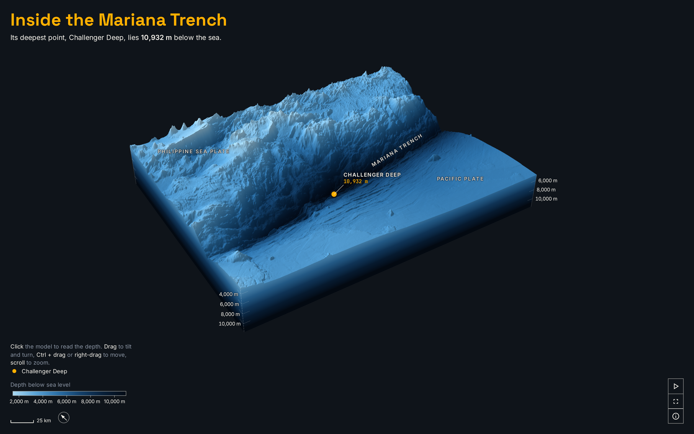
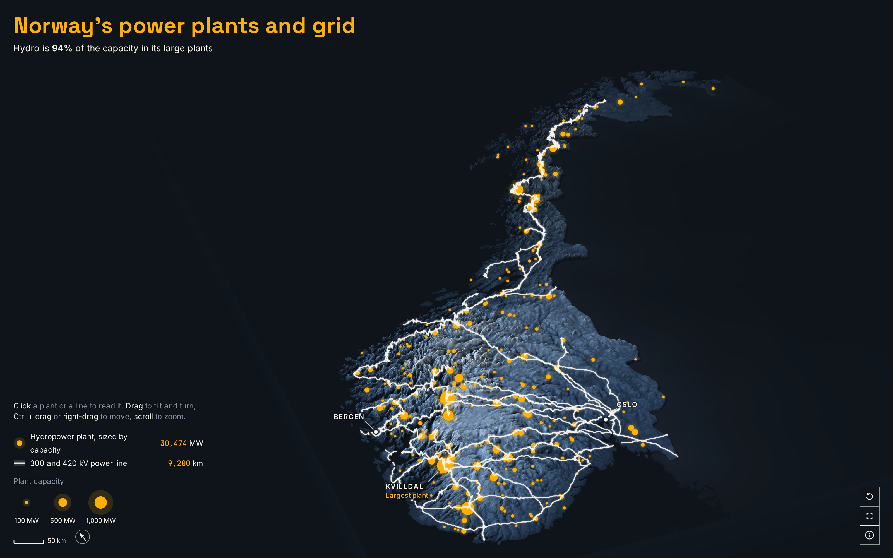
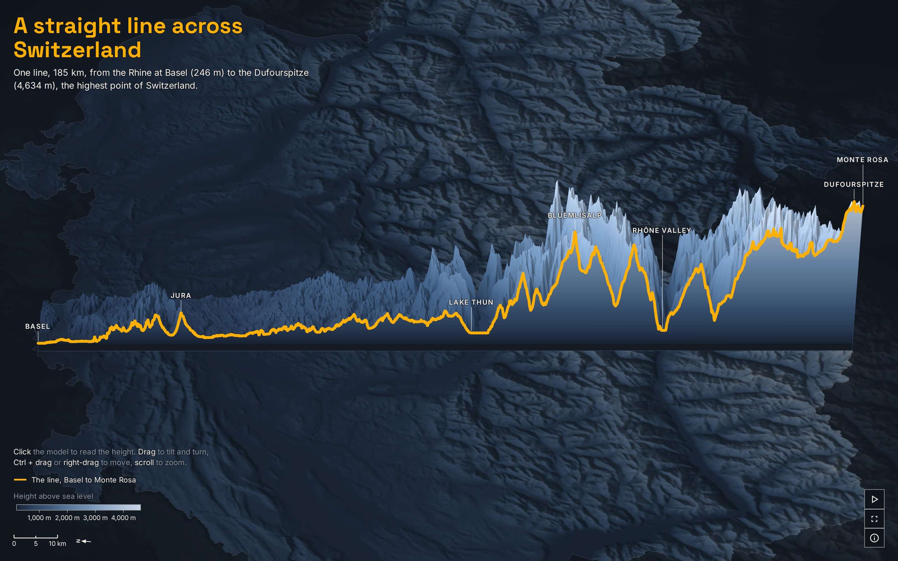

# AtlasLab by Laurenz

Live maps: https://laurenzthiele.github.io/Atlas-Lab/

Maps made from free, open data. Each comes with its code and data steps, so anyone can rebuild it.

| Snapshot | Title | Description | Folder | Live map |
|---|---|---|---|---|
|  | The roads of the Roman Empire | Every known Roman road, 299,171 km of it, drawn outward from Rome as an old atlas plate. | [roman-roads-atlas](roman-roads-atlas/) | [Open](https://laurenzthiele.github.io/Atlas-Lab/roman-roads-atlas/) |
|  | The rain that drowned Florence | The 4,600 km² of hills whose rain all drains under Ponte Vecchio, the basin that flooded Florence on 4 November 1966, as a 3D relief map you can tilt and trace. | [florence-rain-1966](florence-rain-1966/) | [Open](https://laurenzthiele.github.io/Atlas-Lab/florence-rain-1966/) |
|  | Every tsunami on record | Every recorded tsunami runup since 684 on a globe, as rings sized by water height. | [tsunami-ripples](tsunami-ripples/) | [Open](https://laurenzthiele.github.io/Atlas-Lab/tsunami-ripples/) |
|  | Where Egypt's people live | Where Egypt's 115.5 million people live on 1 km squares: 95% of them on 2.2% of the land, along the Nile. | [egypt-nile-dots](egypt-nile-dots/) | [Open](https://laurenzthiele.github.io/Atlas-Lab/egypt-nile-dots/) |
|  | How deep is the Mariana Trench really? | The trench in 3D, down to 10,932 m, with Everest dropped in | [mariana-trench-dive](mariana-trench-dive/) | [Open](https://laurenzthiele.github.io/Atlas-Lab/mariana-trench-dive/) |
|  | Where Norway's power comes from | Norway's large power plants and high-voltage grid in 3D: 94% of the capacity is hydro | [norway-power](norway-power/) | [Open](https://laurenzthiele.github.io/Atlas-Lab/norway-power/) |
|  | Switzerland in one line | One straight line across Switzerland, from 246 m at Basel to 4,634 m on the Dufourspitze | [switzerland-in-one-line](switzerland-in-one-line/) | [Open](https://laurenzthiele.github.io/Atlas-Lab/switzerland-in-one-line/) |

## Licence

The code is MIT licensed (see [LICENSE](LICENSE)). The data stays under each source's own licence,
as listed in each map's README.
