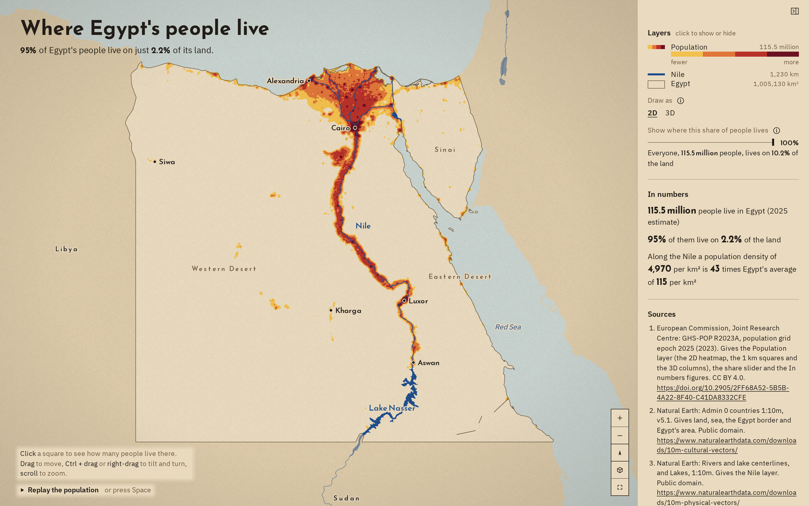

# Where Egypt's people live

95% of Egypt's people live on just 2.2% of its land.



**[Open the live map](https://laurenzthiele.github.io/Atlas-Lab/egypt-nile-dots/)**

Egypt is almost all empty desert, and nearly everyone lives along one river. This map shows it with GHS-POP 2025, the European Commission's population grid, counted on 1 km squares.

## Key figures

All five come from GHS-POP R2023A, epoch 2025 (European Commission JRC), cut to Egypt with the Natural Earth 1:10m border (the Halaib triangle inside, Bir Tawil outside), on 1 km squares of 10 x 10 cells of 100 m in World Mollweide, an equal-area projection. GHS-POP counts 115.5 million people inside the border.

- **95%** of Egypt's people: a fixed threshold, the same 95% that published sources give for the Nile valley and delta.
- **2.2%** of Egypt's area: I rank the 1 km squares by people per km², densest first, and add up the area of the squares that hold 95% of people: 22,090 km² of Egypt's 1,005,130 km².
- **4,970 people per km²** where they live: 95% of the people (109.7 million) on those 22,090 km².
- **115 people per km²** over all of Egypt: 115.5 million people on 1,005,130 km², the same grid and border.
- **43 times** Egypt's average: the two densities divided, both unrounded.

On 100 m cells the same 95% of people fit on 0.9% of the land, because only the rooftops count; on 1 km squares a square with a village counts as lived-in even if half of it is fields. I report 1 km because it is the grid of the Degree of Urbanisation, the UN-endorsed method GHSL itself uses.

[data/key_figures.py](data/key_figures.py) checks its totals against two published figures and stops if either is more than 10% off:

- Figure cited from [Surface area (sq. km) - Egypt, Arab Rep. | Data](https://data.worldbank.org/indicator/AG.SRF.TOTL.K2?locations=EG): 1,001,450 km² (2024).
- Figure cited from [Population, total - Egypt, Arab Rep. | Data](https://data.worldbank.org/indicator/SP.POP.TOTL?locations=EG): 118,365,995 people in 2025 (UN World Population Prospects 2024).

## How I made it

### 1. The data

[data/download.py](data/download.py) fetches everything the map needs. GHSL publishes its population grid for the whole world either as one 4.9 GB zip or as tiles of 1,000 x 1,000 km, and Egypt falls in four of them, 36.4 MB together ([data/download.py, line 47](data/download.py#L47)). I take the World Mollweide version because it is equal-area: every 100 m cell is exactly 0.01 km² wherever it lies, so a share of cells is a share of land, with no correction for latitude. The border, the Nile and the lakes come from Natural Earth. Every download is recorded with its date, size and SHA-256 in `data/raw/sources.json`, so anyone can check they have the same files.

### 2. Rank the squares

[data/key_figures.py, lines 122 to 128](data/key_figures.py#L122-L128):

```python
density = pop / area_km2
order = np.argsort(-density, kind="stable")
cum_pop = np.cumsum(pop[order])
target = SHARE_PEOPLE * cum_pop[-1]
k = np.searchsorted(cum_pop, target) + 1
land_km2 = area_km2[order][:k].sum()
return float(land_km2 / total_km2)
```

I sort every square from most to least crowded and add up land until 95% of the people are counted; `np.searchsorted` finds that point in the running total in one step. I rank by people per km², not by head count, so a border square that is only partly inside Egypt (and so has less area and fewer people) is not favoured or punished. The result is the smallest area that 95% of Egyptians fit on.

### 3. Pick the scale

[data/key_figures.py, lines 131 to 136](data/key_figures.py#L131-L136) sums blocks of 10 x 10 cells of 100 m into 1 km squares; because the grid is snapped to whole kilometres, the blocks line up with GHSL's own 1 km grid. [Lines 165 and 166](data/key_figures.py#L165-L166) run the same ranking on both grids: 0.9% of the land on 100 m cells, 2.2% on 1 km squares. The finer grid leaves out the fields and roads between homes, so it always gives the smaller number. I use 1 km, the grid of the Degree of Urbanisation, and print the 100 m figure next to it, so the choice is visible rather than hidden.

### 4. Smooth it into a heatmap

[maps/prepare.py](maps/prepare.py) writes the 1 km squares to `maps/layers/squares.bin` as plain typed arrays (people, the share of people in denser squares, grid column and row, area), densest first, so the browser reads 100,000 squares without parsing any text. The map draws them with deck.gl's HeatmapLayer, [maps/main.js, lines 686 to 693](maps/main.js#L686-L693):

```js
data: squares.heat,
share: peopleRange[1],
shareFrom: peopleRange[0],
visible: heatOpacity > 0,
opacity: heatOpacity,
radiusPixels: heatRadius,
colorRange: HEAT_COLORS,
aggregation: "SUM",
```

Each square adds its people to the surface (`aggregation: "SUM"`), and `heatRadius` turns `HEAT_RADIUS_M = 8000` metres into pixels at the current zoom, so the blur reaches about 8 km on the ground at every zoom and the valley reads as one glowing band. The colour steps are fixed in people per km² (saffron, orange, red, wine), so the same crowd has the same colour in every view. From zoom 9 the real 1 km squares take over. The slider "Show where this share of people lives" keeps only the most crowded squares that hold the share you pick, filtered on the GPU; `share_curve.json`, written by the same ranking, makes the readout exact.

## The map

MapLibre GL JS with deck.gl layers, in Web Mercator, with no tile server and no terrain. A flat plate drawn from Natural Earth 1:10m (Egypt in sand, its neighbours a step darker, the sea in grey-green haze, the Nile and lakes in Egyptian blue, Egypt's border as a thin line) lies under the People layer.

- **Draw as 2D or 3D:** in 2D a smoothed heatmap that hands over to the real 1 km squares from zoom 9; in 3D each 1 km square is a column raised by its people per km².
- **Show where this share of people lives:** a slider from 50% to 100%; the readout says what share of the land that many people live on.
- **Click a square:** how many people live on it, and where it ranks among Egypt's lived-in squares.
- **In numbers, Sources, About this map and Download the data** in the sheet; the downloads are the 1 km squares as CSV and the three plate layers as GeoJSON.

## Run it yourself

```
cd egypt-nile-dots
uv sync --python 3.12
uv run data/download.py
uv run data/key_figures.py
uv run maps/prepare.py
npm install
npm run dev
npm run snapshot
```

The download is about 46 MB (seven zips) and needs no sign-up or API key. `npm run dev` serves the map at the address it prints; `npm run snapshot` saves `docs/snapshot.png`.

## Script your own views

[maps/main.js](maps/main.js) exports a small API, the same one the page is built on:

```js
import { createMap, ready, setLayers, setTime, setView } from "./main.js";

// Build the map in <div id="map">, with no interface around it.
createMap("map");
// Resolves once the plate, the People layer, the labels and the fonts are drawn.
await ready;
// Fly over the delta.
setView({ center: [31.1, 30.6], zoom: 8, pitch: 30, bearing: 0, duration: 2000 });
// Only the squares that hold 95% of people, as 3D columns.
setLayers(["land_sea", "columns_1km", "nile_lakes", "egypt_border"], { peopleShare: 0.95 });
// One dot for every 250 people, replayed: desert dots first, then the valley from south to north.
setLayers(["land_sea", "egypt_border", "nile_lakes", "dots_all"]);
setTime(0.5);
```

The layer names are `land_sea`, `egypt_border`, `nile_lakes`, `heatmap`, `squares_1km`, `columns_1km`, `squares_95`, `dots_all`, `dots_sparse`, `dots_dense_reveal`, plus `labels:Cairo, Nile (highlight)` for place names. The dots are a random drawing inside each 100 m cell (seeded, so every build is the same), not data.

## Data sources

| Dataset | Publisher | Licence | Credit | Link |
|---|---|---|---|---|
| GHS-POP R2023A, population grid epoch 2025, 100 m, World Mollweide (tiles R6_C21, R6_C22, R7_C21, R7_C22) | European Commission, Joint Research Centre (GHSL) | [CC BY 4.0](https://creativecommons.org/licenses/by/4.0/) | GHS-POP R2023A, Schiavina et al. 2023, European Commission JRC, doi:10.2905/2FF68A52-5B5B-4A22-8F40-C41DA8332CFE | [download](https://human-settlement.emergency.copernicus.eu/download.php) |
| Natural Earth 1:10m admin 0 countries (v5.1) | Natural Earth | [Public domain](https://www.naturalearthdata.com/about/terms-of-use/) | Natural Earth | [zip](https://naciscdn.org/naturalearth/10m/cultural/ne_10m_admin_0_countries.zip) |
| Natural Earth 1:10m rivers and lake centerlines | Natural Earth | [Public domain](https://www.naturalearthdata.com/about/terms-of-use/) | Natural Earth | [zip](https://naciscdn.org/naturalearth/10m/physical/ne_10m_rivers_lake_centerlines.zip) |
| Natural Earth 1:10m lakes | Natural Earth | [Public domain](https://www.naturalearthdata.com/about/terms-of-use/) | Natural Earth | [zip](https://naciscdn.org/naturalearth/10m/physical/ne_10m_lakes.zip) |

- Figure cited from [Surface area (sq. km) - Egypt, Arab Rep. | Data](https://data.worldbank.org/indicator/AG.SRF.TOTL.K2?locations=EG).
- Figure cited from [Population, total - Egypt, Arab Rep. | Data](https://data.worldbank.org/indicator/SP.POP.TOTL?locations=EG).

The layers in `maps/layers/` are in this repo because both licences allow it:

- **GHS-POP:** CC BY 4.0 allows sharing files made from the data with credit and the changes indicated. I cut the grid to Egypt, summed it to 1 km squares and drew the dots from it; the credit is above and in the map's Sources.
- **Natural Earth:** public domain, so the land, border, Nile and lakes layers may be shared freely.

## Folder layout

```
egypt-nile-dots/
  pyproject.toml, uv.lock        Python 3.12 environment (uv)
  package.json, package-lock.json
  data/
    download.py                  fetches the raw data into data/raw/ (not in the repo)
    key_figures.py               computes the figures
    key_figures.json             the figures
  maps/
    prepare.py                   turns data/raw/ into the layers the map loads
    layers/                      the prepared layers
    index.html, ui.js, style.css the page: title, sheet, buttons
    main.js, map.css             the map and its API
    mollweide.js                 the 1 km grid's projection, in the browser
    texture.js, fonts.mjs, fonts/, public/   paper grain, subset fonts, tab icons
    vite.config.js               build settings (npm run build writes maps/dist/)
    snapshot.mjs                 writes docs/snapshot.png
  docs/
    snapshot.png
  README.md
```

## Licence

Code: MIT, see [LICENSE](../LICENSE) at the repo root. Data: under each source's own licence, as listed above.
