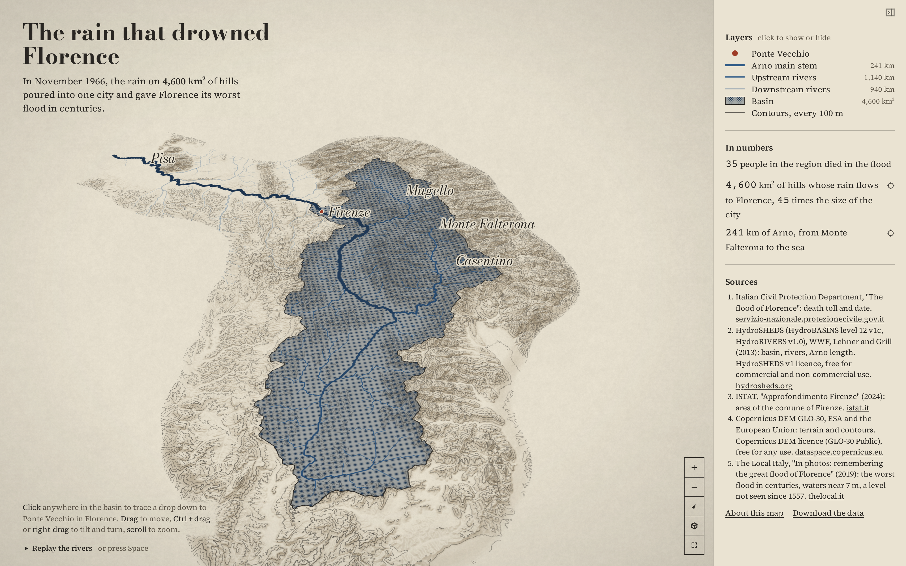

# The rain that drowned Florence

The 4,600 km² of hills whose rain all drains under Ponte Vecchio, the basin that flooded Florence on
4 November 1966, as a 3D relief map you can tilt and trace.



**[Open the live map](https://laurenzthiele.github.io/Atlas-Lab/florence-rain-1966/)**

The rain that drowned Florence fell on the hills upstream, and every stream on them ends at one
bridge.

## Key figures

- **35** people died in the region. Figure cited from the Italian Civil Protection,
  ["The flood of Florence"](https://servizio-nazionale.protezionecivile.gov.it/en/pagina-base/flood-florence/).
- **4 November 1966**: the Arno flooded Florence on the night of 3 to 4 November. Same source.
- **4,600 km²** (4,616.3 km²) of basin drain through Ponte Vecchio: the 33 HydroBASINS level 12
  units upstream of the bridge, measured in EPSG:3035.
- **45 times** (45.1) the size of Florence: the basin area divided by the area of the comune of
  Firenze.
- **241 km** (240.8 km) of Arno, from its spring on Monte Falterona to the sea: 74 HydroRIVERS
  reaches, measured in EPSG:32632.
- **102 km²** (102.31 km²): the area of the comune of Firenze (ISTAT code 048017). Figure cited from
  ISTAT, ["Approfondimento Firenze"](https://www.istat.it/wp-content/uploads/2024/06/Approfondimento_Firenze.pdf)
  (2024).
- **The worst flood in centuries**: the waters reached nearly 7 m, a level not seen since 1557.
  Figure cited from The Local Italy,
  ["In photos: remembering the great flood of Florence"](https://www.thelocal.it/20191104/in-photos-the-great-flood-of-florence-arno-1966)
  (2019).

Every computed figure is written by `data/key_figures.py` to `data/key_figures.json`, with the
method in one line next to it.

## How I made it

1. **`data/download.py` takes a snapshot of open data.** It downloads HydroBASINS, HydroRIVERS and
   nine Copernicus DEM tiles into `data/raw/`, and writes `data/raw/sources.json` with each file's
   licence, credit, download date, size and SHA-256. The checksums matter: if a publisher changes a
   file later, you can tell that your rebuild started from different data.
2. **`data/key_figures.py` rebuilds the basin upstream of Ponte Vecchio.** Every HydroBASINS unit
   knows which unit it drains into (`NEXT_DOWN`). I find the unit that holds the bridge and walk
   that graph upstream: every unit that ends up there is part of the basin. I dissolve them and
   measure the area in EPSG:3035, which is equal-area, so a square metre on the map is a square
   metre on the ground. One data quirk: the 90 m radar elevation behind HydroSHEDS cannot see the
   man-made divide in the flat Val di Chiana, so part of the Chiana, which drains to the Tiber
   today, is routed to the Arno, and the basin comes out a few percent bigger than the official
   sub-basins.
3. **The same script traces the Arno.** I start at the spring on Monte Falterona and follow
   `NEXT_DOWN` reach by reach until it reaches the sea, then measure the length in EPSG:32632 (UTM
   zone 32N), which keeps distances true across Tuscany. I do not start at the mouth and follow the
   biggest branch upstream: in HydroRIVERS that path turns south at Arezzo into the Val di Chiana,
   because in the data the Chiana drains more land than the upper Arno does.
4. **`maps/prepare.py` turns the raw data into small layers for the browser.** It cuts the DEM into
   Terrarium raster-DEM tiles in Web Mercator (elevation packed into the colour of a PNG, which
   MapLibre decodes into 3D terrain), draws contours every 100 m, splits the rivers into those
   upstream and downstream of the bridge, each with its distance to Florence along the network,
   and writes a smoothed Arno for close views. The smoothed line is for display only and never
   goes into a figure. The script prints how far it strays from the raw line.
5. **The viewer (`maps/index.html`, `maps/main.js`, `maps/ui.js`) is MapLibre GL JS with 3D
   terrain.** Click anywhere in the basin and it traces a drop of rain along `NEXT_DOWN` to Ponte
   Vecchio. "Replay the rivers" grows the network from the headwaters towards the bridge, the
   farthest reaches first.

## Run it yourself

You need [uv](https://docs.astral.sh/uv/) and Node 20 or newer. The download is about 460 MB, and
`data/raw/` takes about 930 MB once unzipped (the zips are kept). No sign-up or API key is needed.

```
cd florence-rain-1966
uv sync --python 3.12
uv run data/download.py
uv run data/key_figures.py
uv run maps/prepare.py
npm install
npm run dev
npm run snapshot
```

`npm run dev` serves the map at the address it prints. `npm run snapshot` writes
`docs/snapshot.png`. `npm run build` writes the static site to `maps/dist/`.

## The map API

`maps/main.js` exports a small API, so you can script your own views from your own page:

```js
import { createMap, ready, setLayers, setTime, setView } from "./main.js";

// Build the map in <div id="map"> and wait for the style, the layers and the fonts.
createMap("map");
await ready;

// Move the camera at once. Any of center, zoom, pitch and bearing can be left out.
setView({ center: [11.8, 43.75], zoom: 10, pitch: 60, bearing: -60 }); // over the Casentino

// Say which layers are on. Anything you do not name goes off.
setLayers({ terrain: true, hillshade: true, basin: true, upstream_rivers: true, ponte_vecchio: true });

// Gather the rivers: 0 is none, 1 is the whole network.
setTime(0.5);
```

`setTime` is part of the API every map in this repo shares. On a map with a time dimension it
moves through time. This map has none, so `setTime` stands for how far the water has gathered:
it shows the river network grown from the headwaters, as in "Replay the rivers".

## Data sources

| Dataset | Publisher | Licence | Credit | Link |
|---|---|---|---|---|
| HydroBASINS Europe, level 12, v1c (standard, without lakes) | HydroSHEDS (WWF, McGill University) | HydroSHEDS v1 licence agreement: free for commercial and non-commercial use ([Appendix A of the technical documentation](https://data.hydrosheds.org/file/technical-documentation/HydroSHEDS_TechDoc_v1_4.pdf)) | HydroSHEDS, © World Wildlife Fund, Inc. (2006-2022), used under licence. Lehner and Grill (2013), https://www.hydrosheds.org | [hybas_eu_lev12_v1c.zip](https://data.hydrosheds.org/file/HydroBASINS/standard/hybas_eu_lev12_v1c.zip) |
| HydroRIVERS Europe, v1.0 | HydroSHEDS (WWF, McGill University) | HydroSHEDS v1 licence agreement, as above | as above | [HydroRIVERS_v10_eu_shp.zip](https://data.hydrosheds.org/file/HydroRIVERS/HydroRIVERS_v10_eu_shp.zip) |
| Copernicus DEM GLO-30 (9 tiles, N42 to N44, E010 to E012) | ESA / Copernicus, served by the AWS Open Data Registry | [Copernicus DEM licence (GLO-30 Public)](https://dataspace.copernicus.eu/explore-data/data-collections/copernicus-contributing-missions/collections-description/COP-DEM): free for any use, with the notice in the credit | produced using Copernicus WorldDEM-30 © DLR e.V. 2010-2014 and © Airbus Defence and Space GmbH 2014-2018 provided under COPERNICUS by the European Union and ESA; all rights reserved | [copernicus-dem-30m.s3.amazonaws.com](https://copernicus-dem-30m.s3.amazonaws.com) |

- Figure cited from the Italian Civil Protection,
  ["The flood of Florence"](https://servizio-nazionale.protezionecivile.gov.it/en/pagina-base/flood-florence/):
  the death toll and the date.
- Figure cited from ISTAT,
  ["Approfondimento Firenze"](https://www.istat.it/wp-content/uploads/2024/06/Approfondimento_Firenze.pdf)
  (2024): the area of the comune of Firenze.
- Figure cited from The Local Italy,
  ["In photos: remembering the great flood of Florence"](https://www.thelocal.it/20191104/in-photos-the-great-flood-of-florence-arno-1966)
  (2019): the worst flood in centuries.

**Which prepared layers are in this repo.** `maps/prepare.py` rebuilds every layer from the raw
data, so nothing is lost when a layer is left out.

- **HydroSHEDS:** not in the repo. Its licence allows distributing the data only incorporated
  into a derived product for end users under an end-user licence at least as protective as its
  own, and never as a stand-alone product. A public repo of plain GeoJSON files does not fit that,
  so the basin, river and place layers (`basin`, `basin_units`, `rivers_upstream`,
  `rivers_downstream`, `arno`, `arno_display`, `points`) are ignored by git. The live map uses
  them with the attribution Exhibit B of the licence asks for, in About this map.
- **Copernicus DEM:** `contours.geojson` is in the repo. The licence grants reproduction,
  distribution and adaptation, as long as the notice in the table goes with it, plus this
  sentence: "The organisations in charge of the Copernicus programme by law or by delegation do
  not incur any liability for any use of the Copernicus WorldDEM-30". This project is not endorsed
  by the Copernicus programme. The terrain tiles are left out only because of their size:
  thousands of small files would bloat the history.
- **Made here, from no source data:** `key_figures.json`, `meta.json` and the two textures
  (`halftone.png`, `paper.png`, drawn by `prepare.py` from a fixed seed).

## Folder layout

```
florence-rain-1966/
  pyproject.toml, uv.lock          Python 3.12 environment (uv)
  package.json, package-lock.json  MapLibre, Vite and Playwright
  data/
    download.py                    downloads the raw data and writes raw/sources.json
    key_figures.py                 computes the key figures
    key_figures.json               the key figures, with source and method
    raw/                           downloaded files (not in the repo)
  maps/
    prepare.py                     turns data/raw/ into maps/layers/
    index.html, ui.js, style.css   the page around the map
    main.js                        the map and its API
    vite.config.js                 dev server and build
    snapshot.mjs                   writes docs/snapshot.png
    public/                        tab icons
    layers/                        prepared layers (only some are in the repo, see above)
  docs/
    snapshot.png
  README.md
```

## Licence

The code is MIT licensed (see [LICENSE](../LICENSE) at the repo root). The data stays under each
source's own licence, as listed above.
