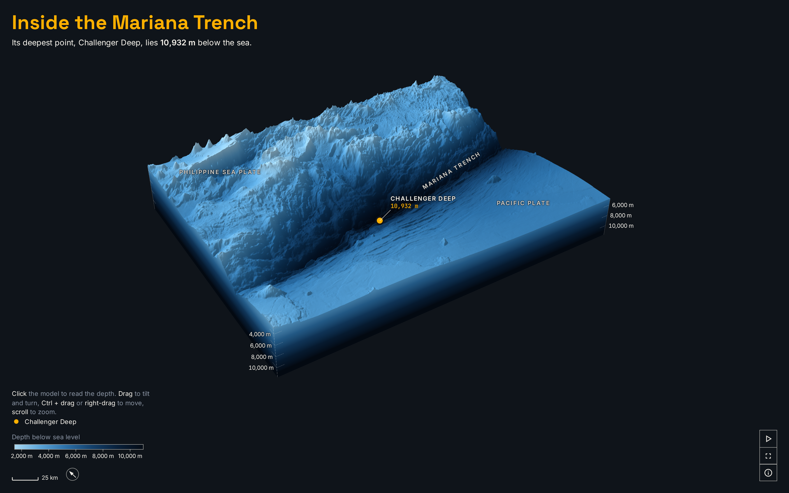

# How deep is the Mariana Trench really?

A 3D model of the southern Mariana Trench, from the sea surface down to its deepest point, 10,932 m below sea level, with Everest set into the trench at the same scale.



**[Open the live scene](https://laurenzthiele.github.io/Atlas-Lab/mariana-trench-dive/)**

You can turn, tilt, move and zoom the model and click anywhere on it to read the depth. Play runs a short animation: a dive along the trench to its deepest point, a cut through it, and Everest set into the cut, where its peak still stays 2,083 m under the sea.

## Key figures

- **10,932 m** deep at the bottom: the deepest cell of the GMRT seafloor grid (10,932.5 m below sea level). I check it against the published depth of Challenger Deep, 10,935 m ± 6 m ([Greenaway et al. 2021](https://repository.library.noaa.gov/view/noaa/33477)): 2.5 m shallower, inside the published uncertainty.
- **Challenger Deep at 11.33° N 142.21° E**: the centre of that cell (GMRT), 0.71 km from the published position at 11.332° N 142.202° E ([Stewart and Jamieson 2019](https://ui.adsabs.harvard.edu/abs/2019ESRv..19702896S)).
- **Everest 8,849 m**: 8,848.86 m, the height from the China and Nepal joint survey announced on 8 December 2020.
- **2,083 m** of water still above Everest's peak if it stood on the floor at Challenger Deep: 10,932 m minus 8,849 m, both rounded, so the screen adds up. With the published depth it is 2,086 m.
- **About 240 m** per grid cell: the mean cell width and height of the GMRT grid at the deepest point (GMRT's own metadata gives 244.6 m per node).

## How I made it

1. **The data.** [data/download.py](data/download.py) asks the GMRT GridServer for one GeoTIFF of the box from 140.6 to 143.8° E and 10.2 to 12.6° N ([line 34](data/download.py#L34)), instead of downloading the whole planet. GMRT merges ship sonar surveys into one grid, so over a well-surveyed trench it is much sharper than global grids. Every download is recorded with its date, size and SHA-256 in `data/raw/sources.json`.
2. **The deepest cell.** [data/key_figures.py](data/key_figures.py) finds the deepest cell ([line 75](data/key_figures.py#L75)) and checks it against the published depth and position of Challenger Deep ([lines 35 to 43](data/key_figures.py#L35-L43)) before it writes `data/key_figures.json`.
3. **Small layers for the browser.** [maps/prepare.py](maps/prepare.py) fills the empty last rows GMRT leaves at the edge of a box, shrinks the grid to 729 x 558 cells with an area average, and stores the heights in a PNG that keeps them exact to 4 mm ([`terrarium_png`](maps/prepare.py#L361)): a height in metres does not fit one 8-bit colour channel, so it is spread over red, green and blue. It also cuts a full-resolution depth profile through the deepest cell for the cut face ([`section_profile`](maps/prepare.py#L385)).
4. **The model.** [maps/scene.js](maps/scene.js) builds the block in three.js: one vertex per grid cell, coloured by depth, lit by one light from the north-west, with the depth drawn 6 times taller than it is so the trench shape reads. The side walls carry the same colour ramp down to the base, with depth ticks every 2,000 m. Everest is a cone 8,848.86 m tall, drawn at the same 6 times scale.
5. **The animation.** [maps/timeline.js](maps/timeline.js) is one paused GSAP timeline that Play runs. Nothing in it follows the clock: every value is set from the frame number, so the same frame always looks the same. The camera's dive passes through several keys on one smooth curve ([`monotoneCubic`](maps/timeline.js#L33)), so it never jolts at a key.

## The scene API

[maps/scene.js](maps/scene.js) draws the model without the page around it, so you can script your own views:

```js
import config from "./layers/scene.json";
import { createScene } from "./scene.js";

const scene = createScene(document.getElementById("scene"), {
  config,
  urls: { relief: "layers/relief.png", section: "layers/section.json" },
});
await scene.ready;
scene.setFrame(240); // jump to any of the animation's frames (scene.frames in all)
scene.play();        // run it from the current frame
scene.stop(scene.startView({ left: 0, right: innerWidth, top: 0, bottom: innerHeight }));
```

`setFrame(frame)` shows one frame, `play()` runs the animation, `stop(view)` eases back to a view, and `frames` is the number of frames. `pick(x, y)` returns the depth and position under a screen point.

## Run it yourself

```
cd mariana-trench-dive
uv sync --python 3.12
uv run data/download.py
uv run data/key_figures.py
uv run maps/prepare.py
npm install
npm run dev
npm run build
npm run snapshot
```

`npm run dev` serves the scene at http://localhost:5173/maps/. `npm run snapshot` saves `docs/snapshot.png` from the built page, so it needs `npm run build` first.

## Data sources

| Dataset | Publisher | Licence | Credit | Link |
|---|---|---|---|---|
| GMRT Global Multi-Resolution Topography synthesis, medium resolution, box 140.6 to 143.8° E, 10.2 to 12.6° N | Lamont-Doherty Earth Observatory, Columbia University | CC BY 4.0 | Ryan, W.B.F. et al. (2009), Global Multi-Resolution Topography (GMRT) synthesis data set, Geochem. Geophys. Geosyst., 10, Q03014, doi:10.1029/2008GC002332. Data doi:10.1594/IEDA.100001 | https://www.gmrt.org/ (terms: https://www.gmrt.org/about/terms_of_use.php) |
| Mount Everest height, 8,848.86 m | China and Nepal joint survey, 2020 | published figure | China and Nepal joint survey, announced 8 December 2020 | https://www.aljazeera.com/news/2020/12/8/mt-everest-nepal-china-announce-revised-height-at-8848-metres |

## Folder layout

```
mariana-trench-dive/
  README.md
  pyproject.toml, uv.lock          Python 3.12 with uv
  package.json, package-lock.json  three.js, GSAP, Vite, Playwright
  vite.config.js
  data/
    download.py                    fetches the GMRT box into data/raw/ (not tracked)
    key_figures.py                 the deepest cell and the other figures
    key_figures.json
  maps/
    prepare.py                     data/raw/ to the small layers below
    layers/                        relief.png, section.json, scene.json, figures.json, meta.json
    index.html, ui.js, style.css   the page around the model
    scene.js                       the 3D model (createScene)
    timeline.js                    the animation
    format.js                      figures with their units, never broken apart
    snapshot.mjs                   npm run snapshot
    public/                        tab icons
  docs/
    snapshot.png
```

## Licence

The code is MIT licensed (see [LICENSE](../LICENSE)). The GMRT data and the layers made from it (`maps/layers/relief.png`, `section.json`) are CC BY 4.0: Ryan, W.B.F. et al. (2009), Global Multi-Resolution Topography (GMRT) synthesis data set, Geochem. Geophys. Geosyst., 10, Q03014, doi:10.1029/2008GC002332.
