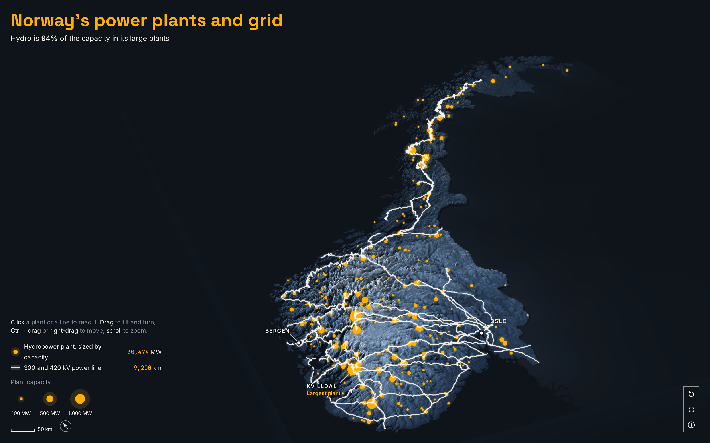

# Where Norway's power comes from

A 3D map of Norway's large power plants and its high-voltage grid on the relief: hydro is 94% of the capacity in the large plants (WRI database, 2021).



**[Open the live map](https://laurenzthiele.github.io/Atlas-Lab/norway-power/)**

When the page opens, the 291 hydropower plants light up one by one, largest first, and then the 300 and 420 kV lines draw themselves outward from the plants over the ridges to the cities. You can turn, tilt and zoom while it draws, and click a plant or a line to read it.

## Key figures

- **94%** of the capacity in Norway's large plants is hydro: 30,474 MW of 32,551 MW over the 306 Norwegian plants in the Global Power Plant Database v1.3.0 (WRI, 2021).
- **30,474 MW** of hydropower in **291** large plants (Global Power Plant Database v1.3.0).
- **Kvilldal** is the largest plant (Global Power Plant Database v1.3.0; Statkraft also lists it as [Norway's largest](https://www.statkraft.com/Global-presence/norway/kvilldal-hydropower-plant/)). The database gives it more capacity than Statkraft does, so the map names it and shows no MW.
- **9,200 km** (9,154 km) of 300 and 420 kV lines, measured on the OpenStreetMap power lines cut to the mainland, 4.0% more than the 8,798 km in [Statnett's annual report 2021](https://www.statnett.no/globalassets/om-statnett/investorrelasjoner/arsrapporter/statnett-arsrapport-2021.pdf) (OpenStreetMap is from today, and Statnett keeps upgrading 300 kV lines to 420 kV).

The database only lists the large plants and dates from 2021, so small hydro and most wind farms are missing: Norway's official hydro share ([SSB](https://www.ssb.no/en/energi-og-industri/energi/statistikk/elektrisitet), installed capacity 2021) is 84.6%. The 291 plants are not all of Norway's hydropower plants either; NVE counts 1,791 (end of 2024).

## How I made it

1. [data/download.py](data/download.py) fetches the Global Power Plant Database, the power lines of 100 kV and more and the city points from OpenStreetMap (through the Overpass API), the 120 Copernicus DEM GLO-90 relief tiles over mainland Norway and the Natural Earth country outlines. Every download is recorded with its date, size and SHA-256 in `data/raw/sources.json`.
2. [data/key_figures.py](data/key_figures.py) sums the plant capacity by fuel and the line lengths by voltage, and checks every figure against a published one: SSB for the capacity, NVE for the number of plants, Statkraft for Kvilldal and Statnett for the line length. Lengths are geodesic, on the WGS84 ellipsoid, because mainland Norway spans six UTM zones and no single projection keeps its length true end to end.
3. [maps/prepare.py](maps/prepare.py) puts everything on one grid in EPSG:25833 (ETRS89 / UTM 33N), Norway's national projection, which keeps the long country in its true shape. It averages the relief tiles to 1 km heights and a 500 m relief texture, sorts the plants by capacity (the order they light up in) and orders the lines by their distance from the nearest plant, so the network grows outward from the plants.
4. [maps/scene.js](maps/scene.js) builds the 3D model in three.js: a closed relief block with heights drawn 9 times taller than they are, plant discs sized by capacity (area grows with the MW), and the lines as ribbons draped on the relief. The whole drawing is two numbers on the GPU: every plant compares its own light time with one clock, and every line vertex compares its distance along the network with one drawn length.
5. [maps/timeline.js](maps/timeline.js) is the GSAP timeline that drives those two numbers frame by frame, so the drawing on load is the same on every screen and every run.

## Run it yourself

```
cd norway-power
uv sync --python 3.12
uv run data/download.py
uv run data/key_figures.py
uv run maps/prepare.py
npm install
npm run dev
npm run snapshot
```

`data/download.py` fetches about 250 MB, mostly the relief tiles, and needs no sign-up or API key; the OpenStreetMap queries can take a few minutes when the Overpass API is busy. `npm run dev` serves the map at the address it prints, under `/maps/`. `npm run snapshot` photographs the built page, so run `npm run build` before it; it saves `docs/snapshot.png`.

## Script your own views

[maps/scene.js](maps/scene.js) exports `createScene(container, options)`, the same model the page is built on, without any of the page around it:

```js
import config from "./layers/scene.json";
import { createScene } from "./scene.js";

const scene = createScene(document.getElementById("scene"), { config });
await scene.ready; // relief, plants and lines loaded and drawn

scene.setFrame(240); // a still of the drawing, 240 frames (8 s) in: every plant lit
scene.play({ from: 135, to: 345 }); // run the drawing at 30 frames per second
scene.stop();
console.log(scene.frames); // 465 frames on the timeline
```

`setFrame(frame, { camera: true })` also runs the built-in camera flight over the model: from straight above, into Jotunheimen, back out over the whole country and round again.

## Data sources

| Dataset | Publisher | Licence | Credit | Link |
|---|---|---|---|---|
| Global Power Plant Database v1.3.0 | World Resources Institute (WRI) | CC BY 4.0 | Global Energy Observatory, Google, KTH Royal Institute of Technology in Stockholm, Enipedia, World Resources Institute. 2021. Global Power Plant Database v1.3.0. Published on Resource Watch and Google Earth Engine. | [download](https://wri-dataportal-prod.s3.amazonaws.com/manual/global_power_plant_database_v_1_3.zip) |
| OpenStreetMap power lines of 100 kV and more, and cities, in Norway (Overpass API) | OpenStreetMap Foundation and contributors | ODbL 1.0 | © OpenStreetMap contributors | [copyright](https://www.openstreetmap.org/copyright) |
| Copernicus DEM GLO-90 (120 tiles over mainland Norway) | ESA / Copernicus, served by the AWS Open Data Registry | Copernicus DEM licence, free for any use with notice | Produced using Copernicus WorldDEM-90 © DLR e.V. 2010-2014 and © Airbus Defence and Space GmbH 2014-2018 provided under COPERNICUS by the European Union and ESA; all rights reserved | [tiles](https://copernicus-dem-90m.s3.amazonaws.com), [licence](https://dataspace.copernicus.eu/explore-data/data-collections/copernicus-contributing-missions/collections-description/COP-DEM) |
| Natural Earth 1:10m Admin 0 Countries | Natural Earth (NACIS) | Public domain | Made with Natural Earth | [download](https://naciscdn.org/naturalearth/10m/cultural/ne_10m_admin_0_countries.zip) |

## Folder layout

```
norway-power/
  pyproject.toml, uv.lock          Python dependencies (uv)
  package.json, package-lock.json  JavaScript dependencies (npm)
  vite.config.js                   build settings for the page
  data/
    download.py                    fetches the raw data into data/raw/
    key_figures.py                 computes and checks the figures
    key_figures.json               the figures, with sources and checks
  maps/
    prepare.py                     turns data/raw/ into maps/layers/
    layers/                        heights.png, relief.webp, plants.json, lines.json, scene.json, meta.json
    index.html, ui.js, style.css   the page: title, legend, buttons, notes, About this scene
    scene.js                       the 3D model (createScene)
    timeline.js                    the frame-based GSAP timeline
    format.js                      figures with their units
    snapshot.mjs                   saves docs/snapshot.png
    public/                        tab icons
  docs/
    snapshot.png
```

## Licence

The code is MIT (see [LICENSE](../LICENSE)). The plant data in `maps/layers/plants.json` is CC BY 4.0 (World Resources Institute). The line and city layers in `maps/layers/lines.json` and `scene.json` are ODbL 1.0, © OpenStreetMap contributors. The relief in `maps/layers/heights.png` and `relief.webp` was produced using Copernicus WorldDEM-90 © DLR e.V. 2010-2014 and © Airbus Defence and Space GmbH 2014-2018 provided under COPERNICUS by the European Union and ESA; all rights reserved.
