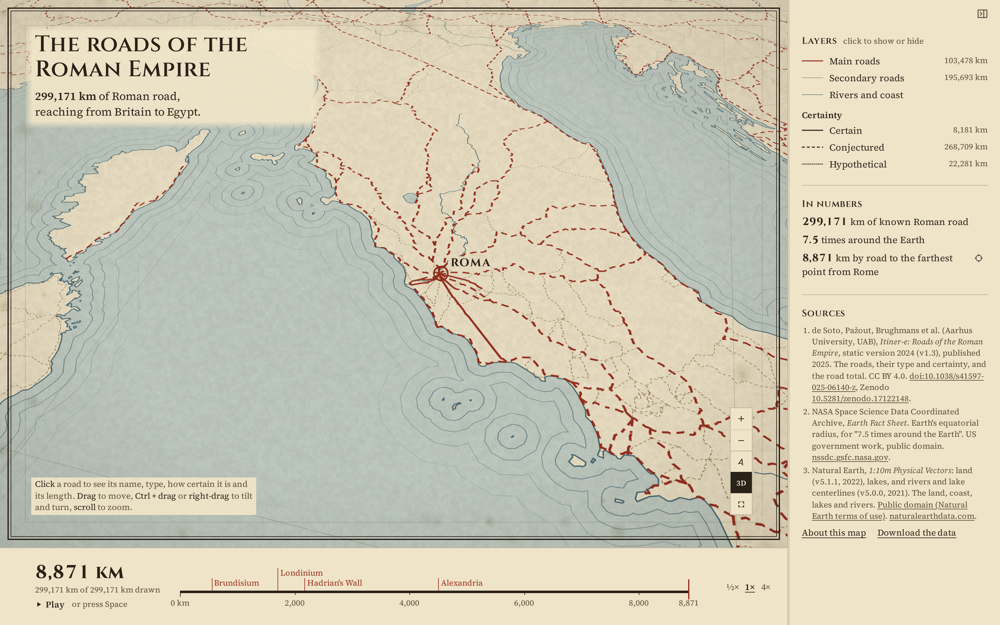

# The roads of the Roman Empire

299,171 km of Roman road, reaching from Britain to Egypt.



**[Open the live map](https://laurenzthiele.github.io/Atlas-Lab/roman-roads-atlas/)**

Every known road of the Roman Empire, all 14,769 segments of the Itiner-e atlas, on a globe drawn
like a plate from a 19th-century hand-coloured atlas: Parchment land, a Verdigris sea, engraved
coast lines and a 5 degree graticule. Main roads are Rubric red, secondary roads Sepia, and the line
pattern says how sure scholars are of each route: certain solid, conjectured dashed, hypothetical
dotted. Press Play on the timeline and the network inks itself outward from Rome, ordered by the
distance from Rome along the roads themselves, with a running count of the kilometres drawn. Click
an entry in the key to show or hide a road type or a certainty class, and hover or tap a road for
its name, type, certainty, length and bibliography.

## Key figures

- **299,171 km** of known Roman road: the sum of the geodesic lengths of all 14,769 segments on the
  WGS84 ellipsoid; it matches the total in the dataset paper. Source: Itiner-e 2024
  (de Soto et al. 2025), [doi:10.1038/s41597-025-06140-z](https://doi.org/10.1038/s41597-025-06140-z).
- **7.5 times around the Earth**: 299,171 km divided by the Equator's 40,075 km
  (2 pi x the WGS84 equatorial radius of 6,378.137 km). Source: Itiner-e 2024
  (de Soto et al. 2025). Figure cited from
  [Earth Fact Sheet](https://nssdc.gsfc.nasa.gov/planetary/factsheet/earthfact.html) (the
  equatorial radius).
- **8,871 km** by road to the farthest point from Rome: the shortest network distance from Rome to
  the farthest road piece, rounded up to the whole km. Source: Itiner-e (de Soto et al. 2025).

Why geodesic lengths: the GeoPackage is stored in World Mercator (EPSG:3395), and summing lengths
in that projection overstates them by about 34 % at these latitudes, so I measure every line on the
ellipsoid instead.

## How I made it

1. **[data/download.py](data/download.py)** downloads one GeoPackage from Zenodo, checked against
   the MD5 that Zenodo lists for it, and three Natural Earth layers (land, lakes, rivers). It
   records each file with its date, size and SHA-256 in `data/raw/sources.json`, and notes for each
   source whether its licence lets me share files made from it.
2. **[data/key_figures.py](data/key_figures.py)** measures length on the ellipsoid, not on the
   projection. The file is in World Mercator, which stretches every distance by 1 / cos(latitude),
   so I measure each segment with `pyproj.Geod` on WGS84. The total matches the paper's.
3. **[maps/prepare.py](maps/prepare.py), the network**: I snap the segment ends that lie within
   25 m of each other into the nodes of one graph, run Dijkstra from Rome, and cut every road into
   pieces of at most 3 km that carry their network distance from Rome, `d`. That one number drives
   the draw from Rome and the running counter (`draw_curve.json`).
4. **maps/prepare.py, the plate**: Natural Earth land, lakes and rivers clipped to the empire, the
   engraved water lines as rings buffered out from the coast, and a 5 degree graticule. The roads
   and the plate are cut into vector tiles, each in one PMTiles archive, so the browser loads only
   the part on screen.
5. **The viewer, [maps/](maps/)**: MapLibre GL JS on a globe. A filter on `d` draws the roads
   outward from Rome, and line patterns show how certain scholars are of each route, so colour
   (road type) and pattern (certainty) never compete.

## Run it yourself

```
cd roman-roads-atlas
uv sync --python 3.12
uv run data/download.py
uv run data/key_figures.py
uv run maps/prepare.py
npm install
npm run dev
npm run snapshot
```

The download is about 41 MB and needs no sign-up and no API key. `npm run dev` serves the map;
open the address it prints. `npm run snapshot` saves `docs/snapshot.png`.

## Script your own views

`maps/main.js` exports a small API, so you can drive the map from your own page:

```js
import { createMap, ready, setLayers, setTime, setView } from "./main.js";

// Build the map inside an element; ready resolves once the start view is fully drawn.
createMap(document.getElementById("plate"));
await ready;

// The camera, at once: over Hadrian's Wall, tilted.
setView({ center: [-2.3, 55.0], zoom: 6, pitch: 50, bearing: 160 });

// Which layers are on: here the roads drawn with their certainty pattern.
setLayers({ sea: true, land: true, coast_ripples: true, roads_certainty: true, rome_marker: true });

// The draw from Rome: only the roads within 1,500 km of Rome by road.
setTime(1500);
```

## Data sources

| Dataset | Publisher | Licence | Credit | Link |
|---|---|---|---|---|
| Itiner-e: Roads of the Roman Empire, static version 2024 (v1.3), itinere_roads.gpkg | de Soto et al., Itiner-e project (Zenodo) | [CC BY 4.0](https://creativecommons.org/licenses/by/4.0/) | Itiner-e, de Soto et al. 2025, Scientific Data, doi:10.1038/s41597-025-06140-z | [zenodo.org/records/17122148](https://zenodo.org/records/17122148) (doi:10.5281/zenodo.17122148) |
| Natural Earth 1:10m land (ne_10m_land) | Natural Earth (NACIS) | [Public domain](https://www.naturalearthdata.com/about/terms-of-use/) | Made with Natural Earth. Free vector and raster map data @ naturalearthdata.com | [naturalearthdata.com](https://www.naturalearthdata.com/downloads/10m-physical-vectors/) |
| Natural Earth 1:10m lakes (ne_10m_lakes) | Natural Earth (NACIS) | Public domain | Made with Natural Earth. Free vector and raster map data @ naturalearthdata.com | same page |
| Natural Earth 1:10m rivers and lake centerlines (ne_10m_rivers_lake_centerlines) | Natural Earth (NACIS) | Public domain | Made with Natural Earth. Free vector and raster map data @ naturalearthdata.com | same page |

Figure cited from [Earth Fact Sheet](https://nssdc.gsfc.nasa.gov/planetary/factsheet/earthfact.html)
(Earth's equatorial radius, for "7.5 times around the Earth").

What the licences allow for the layers in this repo:

- **Itiner-e (CC BY 4.0)**: files made from it may be shared, with the credit above next to them.
  The road layers built from it are allowed; the credit is in this README and in the map.
- **Natural Earth (public domain)**: files made from it may be shared freely. The plate's layers
  are allowed.

`maps/layers/roads.pmtiles` is not in the repo because of its size (7.5 MB);
`uv run maps/prepare.py` builds it, and every other layer, from the downloaded data.

## Files

```
roman-roads-atlas/
  pyproject.toml, uv.lock        Python dependencies (uv)
  package.json, package-lock.json  JavaScript dependencies and the dev, build, snapshot and deploy scripts
  vite.config.mjs                build settings for the static site in maps/dist/
  data/
    download.py                  downloads the sources into data/raw/
    key_figures.py               computes the key figures into key_figures.json
    key_figures.json
  maps/
    prepare.py                   turns data/raw/ into the layers the map loads
    index.html, app.js, ui.js    the page: title, key, figures, sources, timeline, controls
    main.js                      the map itself and its API
    style.css
    snapshot.mjs                 saves docs/snapshot.png
    layers/                      the prepared layers
    public/                      tab icons
  docs/
    snapshot.png
  README.md
```

## Licence

The code is MIT licensed (see [LICENSE](../LICENSE) at the repo root). The data stays under each
source's own licence, as listed above.
