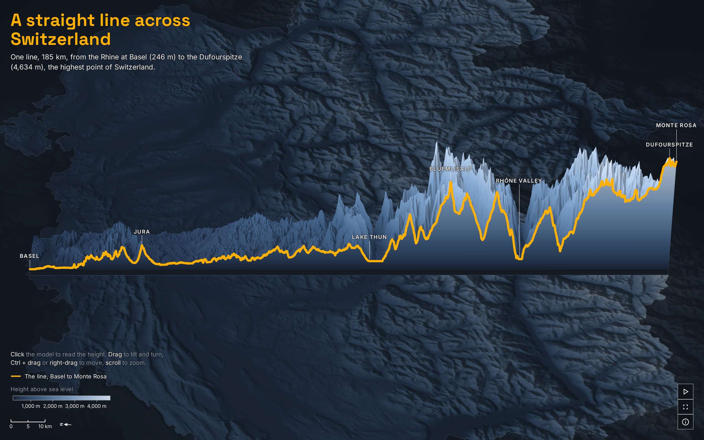

# Switzerland in one line

A 3D model of Switzerland cut open along one straight line, 185 km from the Rhine at Basel to the Dufourspitze, at 4,634 m the highest point of Switzerland.



**[Open the live scene](https://laurenzthiele.github.io/Atlas-Lab/switzerland-in-one-line/)**

I drew one straight line through Basel and the Dufourspitze, cut it where it leaves Switzerland, and read the ground height along it every 30 m. The scene shows the 15 km of land east of the line as a block, cut open along the line, so the cut face is the profile. Click the model to read the height anywhere on it, turn and tilt it, or press Play for a short guided run: the corridor rises out of the map, the camera travels down the cut face, and the block turns side on into a height profile.

## Key figures

- **185 km** from border to border: the straight line through Basel and the Dufourspitze, cut to the Swiss border from swissBOUNDARIES3D 2026-01 (swisstopo) and measured in the Swiss grid LV95. The WGS84 geodesic length is the same 185.4 km.
- **246 m** at Basel, where the line enters Switzerland on the Rhine.
- **1,189 m** in the Jura, the highest point of the line there, near the Hällchöpfli (km 32.9).
- **558 m** at Lake Thun, where the line crosses the lake at Merligen (km 98.6).
- **3,633 m** at the Blüemlisalp, the highest point of the line in the Bernese Alps (km 121.6).
- **634 m** in the Rhône valley near Raron, the lowest point of the line in the Alps (km 142.0).
- **4,634 m** at the Dufourspitze, the highest point of Switzerland, which the line runs over at km 183.4 (swisstopo national map).
- **4,388 m** of climb from Basel to the summit (4,634 m minus 246 m).
- **One height every 30 m**: 6,181 samples along the line.

The five heights from Basel to the Rhône valley come from the Copernicus DEM GLO-30, and [data/key_figures.py](data/key_figures.py) checks each one against swisstopo: the swissALTI3D height service for the four points on land (244.8 m, 1,177.9 m, 3,633.2 m and 633.8 m), and the lake level of the Thunersee (558.0 m) for Lake Thun. All are within 1% of the 30 m model.

The summit height is the official one, not the grid's. The 30 m grid reads the Dufourspitze at 4,535 m, because one grid cell averages a sharp peak with the slopes around it, so I show the surveyed 4,634 m from the swisstopo national map.

## How I made it

1. **The data.** [data/download.py](data/download.py) fetches five Copernicus DEM GLO-30 tiles for the line and its corridor, the GLO-90 tiles over Switzerland for the map under the model, and swisstopo's border (swissBOUNDARIES3D) and place names (swissNAMES3D). Every download is recorded with its date, size and SHA-256 in `data/raw/sources.json`.
2. **The line and its heights.** [data/key_figures.py](data/key_figures.py) finds Basel and the Dufourspitze in swissNAMES3D, draws the straight line through them, extends it and keeps the longest stretch inside Switzerland ([lines 136 to 148](data/key_figures.py#L136-L148)). Then it reads the height every 30 m along that line ([lines 151 to 170](data/key_figures.py#L151-L170)), ties every labelled place to an official swisstopo name point, and checks each figure against swisstopo.
3. **The layers.** [maps/prepare.py](maps/prepare.py) imports those same functions, so the scene draws exactly the line the figures come from. It writes the profile (`profile.json`), the 15 km strip east of the line resampled along the line in 60 m cells (`corridor.png`, heights packed into the colour channels), the shaded map of Switzerland under the model (`base.webp`), the border, the labelled points and the scene settings.
4. **The model.** [maps/scene.js](maps/scene.js) builds the block in three.js: a height-coloured mesh for the land, walls and a cut face coloured by the same ramp, the Amber line along the top of the cut, and the map underneath. Heights are drawn 9 times taller in 3D and 17 times taller in the side view of the animation.
5. **The animation.** [maps/timeline.js](maps/timeline.js) is one paused GSAP timeline that Play runs frame by frame: the camera path, the corridor rising, the turn into the side view, the cursor along the line, and the axes and place labels drawn in the scene.

## Run it yourself

```
cd switzerland-in-one-line
uv sync --python 3.12
uv run data/download.py
uv run data/key_figures.py
uv run maps/prepare.py
npm install
npm run dev
npm run build
npm run snapshot
```

The download is about 375 MB (25 files) and needs no sign-up or API key. `npm run dev` serves the scene at the address it prints (open `/maps/`); `npm run build` writes `maps/dist/`, and `npm run snapshot` saves `docs/snapshot.png` from that build (stop the dev server with Ctrl+C first, or run the last two in a second terminal).

## Draw your own line

The line is one option. Two swisstopo name points and a country code in [data/key_figures.py](data/key_figures.py) define it (`LINE_ANCHORS` and `COUNTRY_ICC`), and the constants block at the top of [maps/prepare.py](maps/prepare.py) holds everything else that belongs to this place: the corridor width, the labelled points, the camera keys and the timing. Nothing in [maps/scene.js](maps/scene.js) or [maps/timeline.js](maps/timeline.js) knows about Switzerland: point the two scripts at another country's border, names and elevation tiles, run them, and the same scene draws the new line.

[maps/scene.js](maps/scene.js) exports a small API, the same one the page is built on:

```js
import config from "./layers/scene.json";
import { createScene } from "./scene.js";

// Build the model in <div id="scene">, with no page furniture around it.
const scene = createScene(document.getElementById("scene"), {
  config,
  urls: {
    profile: "layers/profile.json",
    corridor: "layers/corridor.png",
    base: "layers/base.webp",
    border: "layers/border.json",
  },
});
// Resolves once the first full frame is drawn and the fonts are in.
await scene.ready;
console.log(scene.pageType, scene.frames); // "explainer", 435 frames at 30 fps
// Jump to the side view at 9 s, then play the animation and stop it.
scene.setFrame(270);
scene.play();
scene.stop();
```

## Data sources

| Dataset | Publisher | Licence | Credit | Link |
|---|---|---|---|---|
| Copernicus DEM GLO-30, 2021 release (5 tiles: N45 to N47 E007, N45 and N46 E008) | ESA and the Copernicus programme, served by the AWS Open Data Registry (Sinergise) | [Copernicus DEM licence](https://dataspace.copernicus.eu/explore-data/data-collections/copernicus-contributing-missions/collections-description/COP-DEM), free for any use with the notice | Produced using Copernicus WorldDEM-30 © DLR e.V. 2010-2014 and © Airbus Defence and Space GmbH 2014-2018 provided under COPERNICUS by the European Union and ESA; all rights reserved | [registry.opendata.aws/copernicus-dem](https://registry.opendata.aws/copernicus-dem/) |
| Copernicus DEM GLO-90, 2021 release (the tiles over Switzerland) | ESA and the Copernicus programme, served by the AWS Open Data Registry (Sinergise) | [Copernicus DEM licence](https://dataspace.copernicus.eu/explore-data/data-collections/copernicus-contributing-missions/collections-description/COP-DEM), free for any use with the notice | Produced using Copernicus WorldDEM-90 © DLR e.V. 2010-2014 and © Airbus Defence and Space GmbH 2014-2018 provided under COPERNICUS by the European Union and ESA; all rights reserved | [registry.opendata.aws/copernicus-dem](https://registry.opendata.aws/copernicus-dem/) |
| swissBOUNDARIES3D, release 2026-01 | Federal Office of Topography swisstopo | [swisstopo terms of use for free geodata](https://www.swisstopo.admin.ch/en/terms-of-use-free-geodata-and-geoservices), open use with the source named | Federal Office of Topography swisstopo | [data.geo.admin.ch](https://data.geo.admin.ch/ch.swisstopo.swissboundaries3d/) |
| swissNAMES3D, release 2026 | Federal Office of Topography swisstopo | [swisstopo terms of use for free geodata](https://www.swisstopo.admin.ch/en/terms-of-use-free-geodata-and-geoservices), open use with the source named | Federal Office of Topography swisstopo | [data.geo.admin.ch](https://data.geo.admin.ch/ch.swisstopo.swissnames3d/) |
| Height of the Dufourspitze, 4,634 m | Federal Office of Topography swisstopo, national map | Published figure | swisstopo national map | [Dufourspitze on Wikipedia](https://en.wikipedia.org/wiki/Dufourspitze) |

The layers in `maps/layers/` are in this repo because every source allows it:

- **Copernicus DEM:** the licence allows anyone to use and share the data and files made from it, with the notice above. The profile, the corridor heights and the shaded map are made from it.
- **swisstopo:** free geodata, open for any use with the source named. The border and the labelled points are made from it.

## Folder layout

```
switzerland-in-one-line/
  pyproject.toml, uv.lock          Python 3.12 environment (uv)
  package.json, package-lock.json
  vite.config.js                   build settings (npm run build writes maps/dist/)
  data/
    download.py                    fetches the raw data into data/raw/ (not in the repo)
    key_figures.py                 draws the line, reads its heights, computes the figures
    key_figures.json               the figures
  maps/
    prepare.py                     turns data/raw/ into the layers the scene loads
    layers/                        the prepared layers
    index.html, ui.js, style.css   the page: title, legend, buttons, click to read
    scene.js                       the 3D model and its API
    timeline.js                    the animation, one paused GSAP timeline
    indicators.js                  the labels and axes drawn in the animation
    format.js                      how figures are written (a number never breaks from its unit)
    public/                        tab icons
    snapshot.mjs                   writes docs/snapshot.png
  docs/
    snapshot.png
  README.md
```

## Licence

Code: MIT, see [LICENSE](../LICENSE) at the repo root. Data: under each source's own licence, as listed above.
