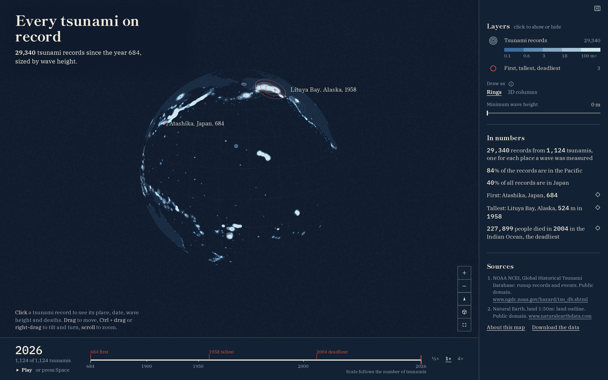

# Every tsunami on record

29,340 tsunami records since the year 684, sized by wave height.



**[Open the live map](https://laurenzthiele.github.io/Atlas-Lab/tsunami-ripples/)**

1,124 tsunamis left 29,340 records on the coasts, and most of them sit around one ocean: the
Pacific, where the Ring of Fire draws itself. Each record is one place where NOAA measured or saw
the water come ashore, drawn as three rings whose area grows with the water height, on an indigo
globe with a 15-degree graticule and a flat tint of the land. You can play the timeline from 684
to 2026, tap a ring for its place, date, water height, deaths and the NCEI event, hide the small
waves with a minimum height, and switch the rings to 3D columns.

## Key figures

All figures come from the NOAA NCEI Global Historical Tsunami Database
([doi:10.7289/V5PN93H7](https://doi.org/10.7289/V5PN93H7)). I count only records rated definite or
probable (validity 3 or 4) with coordinates and a water height above 0 m.

- **29,340 rings**: the records kept by that rule.
- **1,124 tsunamis**: the distinct tsunami events among them.
- **684 to 2026**: the earliest and latest year. The first is Atashika, Japan, 3 m.
- **84% of the rings are in the Pacific**: records in NCEI regions 80 to 89 (83.5%).
- **Japan: 40% of all rings**: no country has more.
- **75% of tsunamis hit the Pacific**: tsunamis whose record nearest the source is in regions 80
  to 89 (74.7%).
- **21% of tsunamis hit Japan**: tsunamis whose record nearest the source is in Japan (20.6%).
- **524 m, Lituya Bay, Alaska, 1958**: the highest water. It was a landslide wave inside a fjord,
  not an ocean tsunami.
- **227,899 deaths, Indian Ocean, 2004**: the deadliest event, its toll copied from the deaths
  column of [NCEI event 2439](https://www.ngdc.noaa.gov/hazel/hazard-service/api/v1/tsunamis/events/2439).

Japan holds 40% of the records but only about a fifth of the tsunamis, because its dense network of
tide gauges logs thousands of places for one big tsunami.

To check my numbers against published ones:

- Figure cited from [NOAA JetStream: Tsunami locations](https://www.noaa.gov/jetstream/tsunamis/tsunami-locations):
  78% of tsunamis in the Pacific and 20% in Japan (mine: 75% and 21%, from this snapshot and my
  nearest-to-source rule).
- Figure cited from [Lituya Bay’s Apocalyptic Wave - NASA Science](https://science.nasa.gov/earth/earth-observatory/lituya-bays-apocalyptic-wave-147557/):
  524 m.

## How I made it

1. **`data/download.py`: a reproducible snapshot of a live database.** The NCEI runup search
   builds its export in the browser from a public JSON API, 200 rows per page. I page through the
   same API, join the pages into one file, and record the download date, size and SHA-256 of
   every file in `data/raw/sources.json`. NCEI adds runups after every tsunami, so those three
   values tell you exactly which version of the database my numbers come from. The script also
   fetches the Natural Earth land polygons.
2. **`data/key_figures.py`: validity, runups and tsunamis.** NCEI rates every event from 0
   (erroneous) to 4 (definite). The rating matters: without it the deadliest "tsunami" would be
   the 1737 Calcutta disaster with 300,000 deaths, which NCEI rates erroneous, because it was a
   cyclone surge. I keep ratings 3 and 4. A runup is one place with one water height; a tsunami
   is one event that can leave thousands of runups. I keep the two apart in every figure, and I
   assign a tsunami to a region by its runup nearest the source, not by where most of its runups
   are.
3. **`maps/prepare.py`: small layers for the browser.** The 29,340 points go out as columns of
   plain JSON (one list per field, only the fields the map reads), about a tenth of the size of
   the same points as GeoJSON. The timeline runs on each tsunami's rank, not on its year: most
   records are after 1900, so a year axis would sit almost empty for most of its length. Ranked
   by tsunami, rings arrive at an even pace and the 2011 Tohoku tsunami (6,193 records) arrives
   as one burst. The Natural Earth land becomes one flat layer of polygons, rounded to 3 decimals
   (about 100 m), finer than a 1:50 million coastline.
4. **The viewer (`maps/main.js`, `maps/ui.js`): a deck.gl globe.** A globe shows the whole Pacific
   rim as one ring, without the Mercator break at 180 degrees that would cut the ocean in two,
   and deck.gl draws every ring on the GPU from typed arrays, so all 29,340 stay smooth. Ring
   area, not radius, grows with water height: radius grows with the square root of height, so a
   524 m wave reads as the giant it is without swallowing the map. Additive blending turns
   density into light, which is why the Pacific coasts glow.

## Run it yourself

You need [uv](https://docs.astral.sh/uv/) and Node.js 20 or newer. From the repo root:

```
cd tsunami-ripples
uv sync --python 3.12
uv run data/download.py
uv run data/key_figures.py
uv run maps/prepare.py
npm install
npm run dev
npm run snapshot
```

The download is 19.6 MB: 18.0 MB from NCEI and 1.6 MB of Natural Earth land. It needs no sign-up
and no API key. `npm run dev` serves the map at the address it prints (the map is under `/maps/`).
`npm run snapshot` needs Playwright's browser once (`npx playwright install --with-deps chromium`)
and writes `docs/snapshot.png`. `npm run build` writes a static site to `maps/dist/`.

## Script your own views

`maps/main.js` exports `createMap`, which draws the globe without any of the page around it and
returns an object with four calls and a promise:

```js
import { createMap } from "./main.js";

// createMap: a globe in any element, loading the layers from maps/layers/.
const map = createMap(document.getElementById("map"), { layersUrl: "layers/" });

// ready: resolves when the layers, fonts and GPU are there.
await map.ready;

// setView: move the camera, giving only what changes. Here: Japan, tilted.
map.setView({ longitude: 138, latitude: 36, zoom: 4.2, pitch: 45, bearing: -20 });

// setLayers: what to show. Here: rings as 3D columns, 2,000 times their real height.
map.setLayers({ rings: false, columns: { exaggeration: 2000, rise: 1 } });

// setTime: a year from 684 to 2026 shows every ring up to the end of that year.
map.setTime(1958);
```

On the live map, open the browser console and use `atlasMap` the same way, for example
`atlasMap.setView({ longitude: 85, latitude: 0, zoom: 2.5 })` for the Indian Ocean.

## Data sources

| Dataset | Publisher | Licence | Credit | Link |
|---|---|---|---|---|
| Global Historical Tsunami Database: all runups (JSON API, joined pages) | NOAA National Centers for Environmental Information (NCEI) | US government work, public domain (no restrictions on use), [doi:10.7289/V5PN93H7](https://doi.org/10.7289/V5PN93H7) | NOAA National Centers for Environmental Information (NCEI), Global Historical Tsunami Database, doi:10.7289/V5PN93H7 | [API](https://www.ngdc.noaa.gov/hazel/hazard-service/api/v1/tsunamis/runups) |
| Global Historical Tsunami Database: region codes | NOAA NCEI | US government work, public domain | NOAA National Centers for Environmental Information (NCEI), Global Historical Tsunami Database, doi:10.7289/V5PN93H7 | [API](https://www.ngdc.noaa.gov/hazel/hazard-service/api/v1/descriptors/tsunami/regions) |
| Natural Earth 1:50m land (ne_50m_land) | Natural Earth (NACIS) | Public domain, [terms of use](https://www.naturalearthdata.com/about/terms-of-use/) | Made with Natural Earth. Free vector and raster map data @ naturalearthdata.com | [Download page](https://www.naturalearthdata.com/downloads/50m-physical-vectors/50m-land/) |

The figure checks above (the NOAA JetStream page and the NASA page) are only comparisons; the map
draws nothing from them.

**The layers in this repo.** `maps/layers/` is tracked here, and the map offers the same files
under "Download the data". Each source allows it:

- NCEI runups and region codes (`rings.json`, `highlights.json`, `regions.json`,
  `ring_of_fire_order.json`, `figures.json`): allowed. A work of the US government has no
  copyright, and the NCEI metadata says "Access to this dataset is unrestricted."
- Natural Earth land (`land.json`): allowed. Natural Earth is in the public domain: "You may use
  the maps in any manner, including modifying the content and design, electronic dissemination,
  and offset printing."

The raw downloads in `data/raw/` stay out of the repo; `uv run data/download.py` fetches them again.

## Files

```
tsunami-ripples/
  README.md
  pyproject.toml, uv.lock          Python dependencies (uv)
  package.json, package-lock.json  JavaScript dependencies and the npm scripts
  vite.config.js                   build settings for the map
  data/
    download.py                    downloads the raw data into data/raw/
    key_figures.py                 computes the key figures
    key_figures.json               the key figures, written by key_figures.py
  maps/
    prepare.py                     turns data/raw/ into the layers the map loads
    index.html, ui.js, style.css   the page around the globe
    main.js                        the globe and its API
    snapshot.mjs                   writes docs/snapshot.png
    public/                        tab icons
    layers/                        the prepared layers, written by prepare.py
  docs/
    snapshot.png                   the picture at the top of this README
```

## Licence

The code is MIT licensed (see [LICENSE](../LICENSE) at the repo root). The data stays under each
source's own licence, as listed above.
