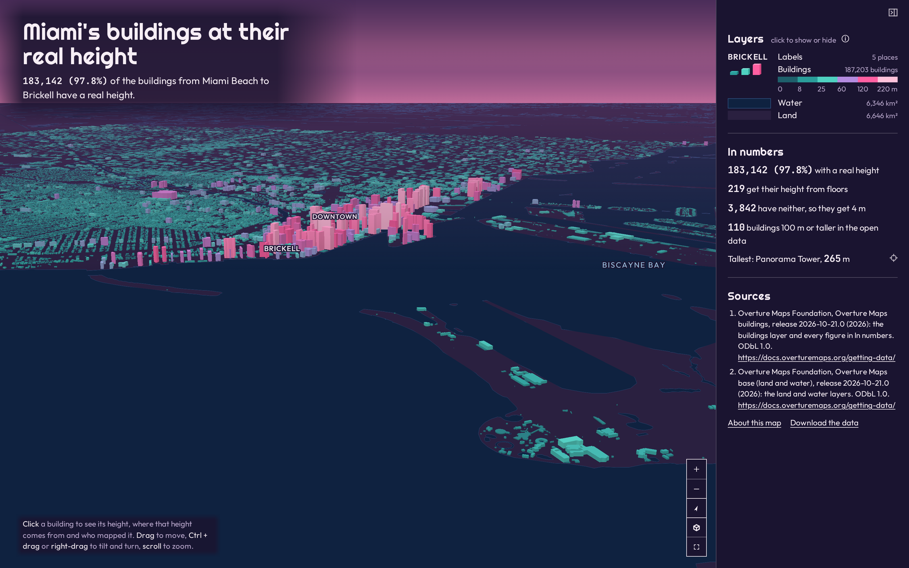

# Miami's buildings at their real height

183,142 (97.8%) of the buildings from Miami Beach to Brickell have a real height.



**[Open the live map](https://laurenzthiele.github.io/Atlas-Lab/vice-city-browser/)**

Every building footprint from Overture Maps in a box from Miami Beach to Brickell and the tip of Key Biscayne, raised to its height and coloured on a teal to pink ramp, under a dusk sky. I had an AI coding agent (Claude Code) build the first version from a three-sentence prompt. It looked great and half of it was made up. What fixed it was a short rules file that says "Only draw what is in the data."

## Key figures

All from Overture Maps buildings, release 2026-10-21.0.

- **187,203** buildings: above-ground footprints that touch the building box
- **183,142 (97.8%)** with a real height: a value in Overture's `height` field
- **219** get their height from floors: no `height` but `num_floors`, so floors x 3.5 m
- **3,842** have neither, so I give them 4 m
- **265 m (Panorama Tower)**: the tallest building in the box
- **110** buildings 100 m or taller, after the height fallbacks

One gap: a few towers keep their height only on Overture's building parts (type `building_part`, which I don't download), so here they stand at their outline height, for example the Four Seasons Hotel Miami at 4 m. That's also part of why 110 towers of 100 m or more is lower than the published skyscraper lists.

## How I made it

### 1. The data

Overture publishes the whole planet as GeoParquet on public S3. You never download all of it: every row carries its own bounding box and the files are sorted in space, so the `overturemaps` library reads only the row groups that touch my box. Three files (buildings, land, water), 62 MB together, no sign-up and no API key.

[data/download.py, lines 139 to 155](data/download.py#L139-L155)

```python
def download_overture(overture_type: str, bbox: tuple, target: Path) -> None:
    """Stream one Overture type inside a box to a GeoParquet file, through a .part file."""
    reader = core.record_batch_reader(
        overture_type,
        bbox=bbox,
        release=RELEASE,
        connect_timeout=CONNECT_TIMEOUT_S,
        request_timeout=TIMEOUT_S,
    )
    if reader is None:
        raise RuntimeError(f"No reader for {overture_type} in release {RELEASE}")
    part = target.with_name(target.name + ".part")
    with get_writer("geoparquet", str(part), schema=reader.schema) as writer:
        copy(reader, writer)
    if part.stat().st_size < 10_000:
        raise RuntimeError(f"{part.name} is only {part.stat().st_size} bytes: empty download?")
    part.replace(target)
```

The land and water come from a wider box than the buildings, about 50 km further out, so the ground reaches the horizon when the camera tilts up. One gotcha: Overture writes its CRS (coordinate reference system) as `OGC:CRS84`, which is plain WGS 84 with longitude first. `set_crs(4326)` throws a CRS mismatch on it, while `to_crs(4326)` works and leaves the coordinates as they are ([data/key_figures.py, lines 51 to 54](data/key_figures.py#L51-L54)). Every download is logged with its date, size and SHA-256 in `data/raw/sources.json`.

### 2. The prompt

The whole prompt is three sentences:

[ai/prompt.txt, lines 1 to 9](ai/prompt.txt#L1-L9)

```
Follow CLAUDE.md. Build a 3D map of
every building in Miami (Overture Maps
buildings, latest release, box
-80.32,25.70,-80.11,25.88) in a neon
dusk look: dark ground, teal and pink by
height, pink sky at the horizon. Then
film a 30 s reel of the camera gliding
south down the coast from Miami Beach to
downtown and save it as reel.mp4.
```

The rules live in a separate file. Claude Code reads a file called CLAUDE.md by itself at the start, so to try it, save [ai/rules-for-claude.md](ai/rules-for-claude.md) as CLAUDE.md in an empty folder, then give Claude Code the prompt.

### 3. Count before you draw

Every building gets a height and a note of where that height came from: the `height` field, else floors x 3.5 m, else 4 m.

[data/key_figures.py, lines 67 to 79](data/key_figures.py#L67-L79)

```python
def add_heights(gdf: gpd.GeoDataFrame) -> gpd.GeoDataFrame:
    """Give every building a height and note where it came from."""
    has_height = gdf["height"].notna()
    has_floors = gdf["num_floors"].notna() & ~has_height
    gdf["height_from"] = "default"
    gdf.loc[has_floors, "height_from"] = "num_floors"
    gdf.loc[has_height, "height_from"] = "height"
    gdf["height_m"] = DEFAULT_HEIGHT_M
    gdf.loc[has_floors, "height_m"] = gdf.loc[has_floors, "num_floors"] * FLOOR_HEIGHT_M
    gdf.loc[has_height, "height_m"] = gdf.loc[has_height, "height"]
    if gdf["height_m"].max() > 400 or gdf["height_m"].min() <= 0:
        raise ValueError(f"Height out of range: {gdf['height_m'].min()} to {gdf['height_m'].max()}")
    return gdf
```

The AI printed the same three groups before it drew anything: 183,142 real, 219 from floors, 3,842 default. That count is what tells you how much of a 3D city is measured and how much is guessed. In Miami almost all of it is measured.

### 4. The fail

With the plain first prompt and no rules ([run 1 in PROMPTS.md](PROMPTS.md#run-1-the-naive-prompt-what-most-people-would-type)), the AI made up lit windows, neon tower tops and traffic so the city would look like a game, and it wrote its own three.js engine instead of using MapLibre. It even said so at the end: "Lighting details are made up."

### 5. The fix

One rule, plus naming the tool:

[ai/rules-for-claude.md, lines 6 to 14](ai/rules-for-claude.md#L6-L14)

```markdown
## Data
- Only draw what is in the data. No fake
  windows, no glow on random buildings,
  no made-up water effects. Light, sky
  and haze for mood are fine.
- Height: use `height`. If missing,
  `num_floors` x 3.5 m. If both are
  missing, 4 m. Print how many buildings
  fall in each group.
```

The same rule holds in this repo. [maps/prepare.py](maps/prepare.py#L276) writes every footprint with its height `h` and where it comes from into one PMTiles file, and [maps/main.js](maps/main.js#L181-L189) colours and raises each building only by `h`. Light, sky and haze set the mood; they add no detail the data doesn't have.

### 6. It checks itself

[ai/rules-for-claude.md, lines 34 to 41](ai/rules-for-claude.md#L34-L41) asks it to render 3 stills along the camera path before recording, look at them and fix what's wrong. The first stills had no sky, because the horizon sat above the frame, and it caught that by itself before filming. Then it filmed the 900 frames of a 30 s video one by one in headless Chromium (wait until the map is loaded, screenshot, next frame) and joined them with ffmpeg.

## Prompts I used

All three runs, word for word, are in [PROMPTS.md](PROMPTS.md). In short: run 1 made up lit windows and traffic and skipped MapLibre. Run 2 put the rules in the prompt. Run 3 moved the rules into a rules file and added the stills check, which caught the missing sky.

## Run it yourself

```
cd vice-city-browser
uv sync --python 3.12
uv run data/download.py
uv run data/key_figures.py
uv run maps/prepare.py
npm install
npm run dev
npm run snapshot
```

The download is 62 MB and needs no sign-up or API key. `maps/prepare.py` needs [tippecanoe](https://github.com/felt/tippecanoe) (2.17 or newer, with its `tile-join`) on your PATH. Overture keeps only about the last two monthly releases online: once 2026-10-21.0 is gone, set `RELEASE` in `data/download.py` to a newer one, and the counts will move a little.

Versions are pinned: MapLibre GL JS 6.18.0 and pmtiles 4.5.0 in `package.json`, Python packages in `uv.lock`.

## The map API

`maps/main.js` is a small API, so you can script your own views:

```js
import { createMap, ready, setView, setLayers, setTime } from "./main.js";

// Draw the map into an element; resolves to { map, figures, meta }.
await createMap("map", { fadeDuration: 0 });
await ready; // the start view is fully drawn: tiles, labels, fonts

// Fly to Miami Beach.
await setView({ center: [-80.13, 25.79], zoom: 14.5, pitch: 70, bearing: 20 }, { duration: 1200 });

// Buildings, water and land, without the place names.
setLayers(["buildings", "water", "land"]);

// This map is one moment in time: setTime resolves at once (every AtlasLab map has it).
await setTime(0);
```

## Data sources

| Dataset | Publisher | Licence | Credit | Link |
|---|---|---|---|---|
| Overture Maps buildings (theme buildings, type building), release 2026-10-21.0, GeoParquet, box -80.32,25.70,-80.11,25.88 | Overture Maps Foundation | [ODbL 1.0](https://docs.overturemaps.org/attribution/) | © OpenStreetMap contributors, Overture Maps Foundation, Microsoft Global ML Building Footprints (ODbL), USGS 3D Elevation Program | https://docs.overturemaps.org/getting-data/ |
| Overture Maps base, land (theme base, type land), release 2026-10-21.0, box -80.80,25.30,-79.65,26.30 | Overture Maps Foundation | [ODbL 1.0](https://docs.overturemaps.org/attribution/) | © OpenStreetMap contributors, Overture Maps Foundation | https://docs.overturemaps.org/getting-data/ |
| Overture Maps base, water (theme base, type water), release 2026-10-21.0, same box | Overture Maps Foundation | [ODbL 1.0](https://docs.overturemaps.org/attribution/) | © OpenStreetMap contributors, Overture Maps Foundation | https://docs.overturemaps.org/getting-data/ |

Can I share the layers made from them? ODbL 1.0 lets anyone share a derived database under the ODbL with the credit.

- Overture Maps buildings: yes, under ODbL 1.0 with the credit above. `buildings.pmtiles` is still not in the repo, only because it's 15.9 MB; `uv run maps/prepare.py` rebuilds it, and the live map serves it.
- Overture Maps land: yes, under ODbL 1.0 with the credit above. It's in the repo (`maps/layers/base.pmtiles`, `maps/layers/download/land.geojson.zip`).
- Overture Maps water: yes, under ODbL 1.0 with the credit above. It's in the repo (`maps/layers/base.pmtiles`, `maps/layers/download/water.geojson.zip`).

## Folder layout

```
vice-city-browser/
  pyproject.toml, uv.lock          Python 3.12 dependencies (uv)
  package.json, package-lock.json  JavaScript dependencies and the npm scripts
  data/
    download.py                    downloads the three Overture files into data/raw/ (not in the repo)
    key_figures.py                 counts the buildings and writes key_figures.json
    key_figures.json
  maps/
    prepare.py                     data/raw/ to the layers the map loads (maps/layers/)
    fonts.py                       cuts the fonts down to the characters the map shows
    index.html, ui.js, main.js, style.css, vite.config.js
    snapshot.mjs                   writes docs/snapshot.png
    layers/                        base.pmtiles, labels, figures, downloads (buildings.pmtiles is built locally)
    fonts/, public/
  ai/
    prompt.txt                     the prompt from run 3
    rules-for-claude.md            the rules file from run 3 (save it as CLAUDE.md)
  docs/snapshot.png
  PROMPTS.md
  README.md
```

## Licence

Code: MIT, see [LICENSE](../LICENSE) at the repo root. Data: ODbL 1.0, as listed under Data sources, with the credit above. `buildings.pmtiles` isn't in the repo because of its size: `uv run maps/prepare.py` builds it from the downloaded data.
